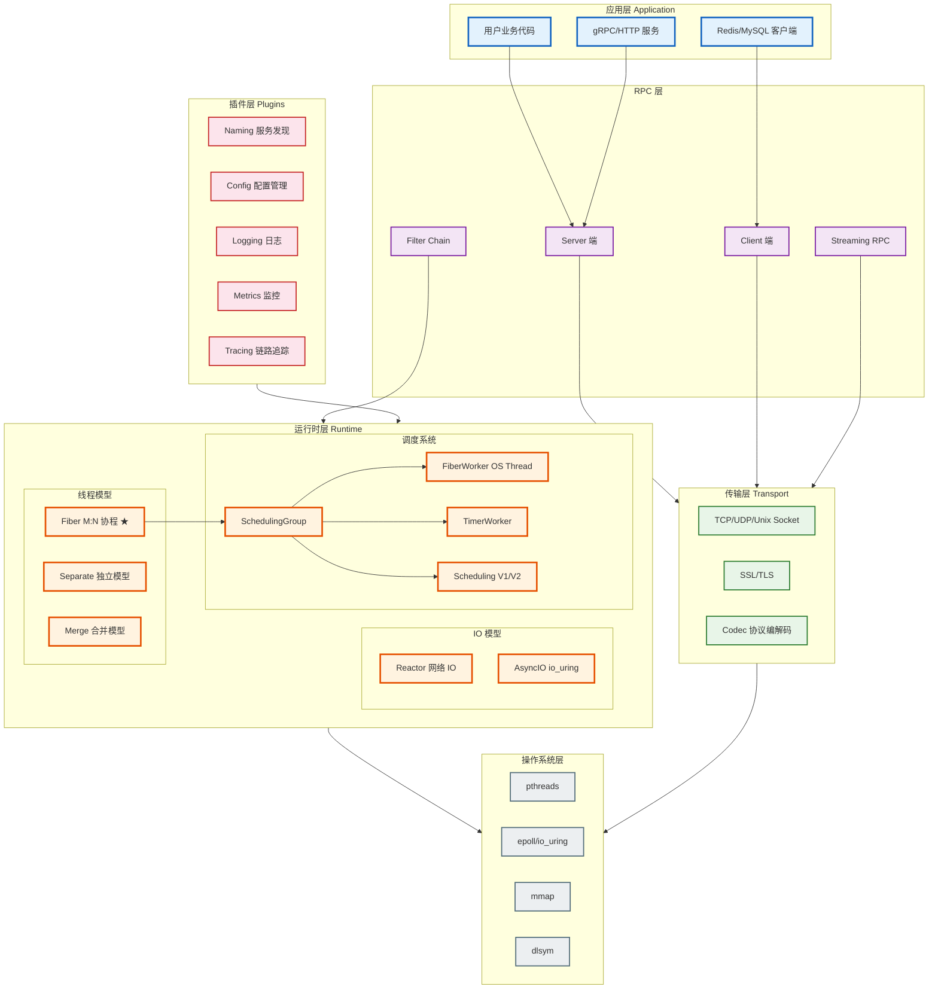
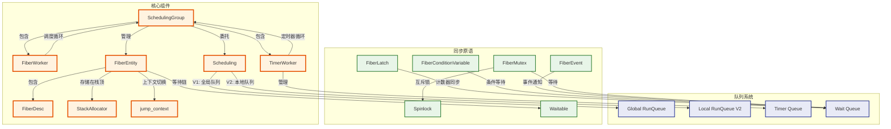
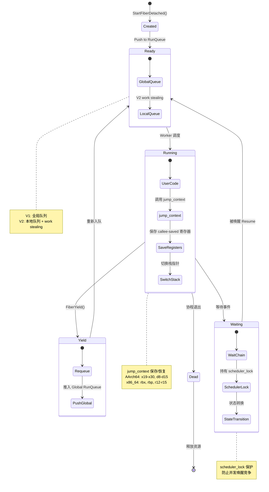
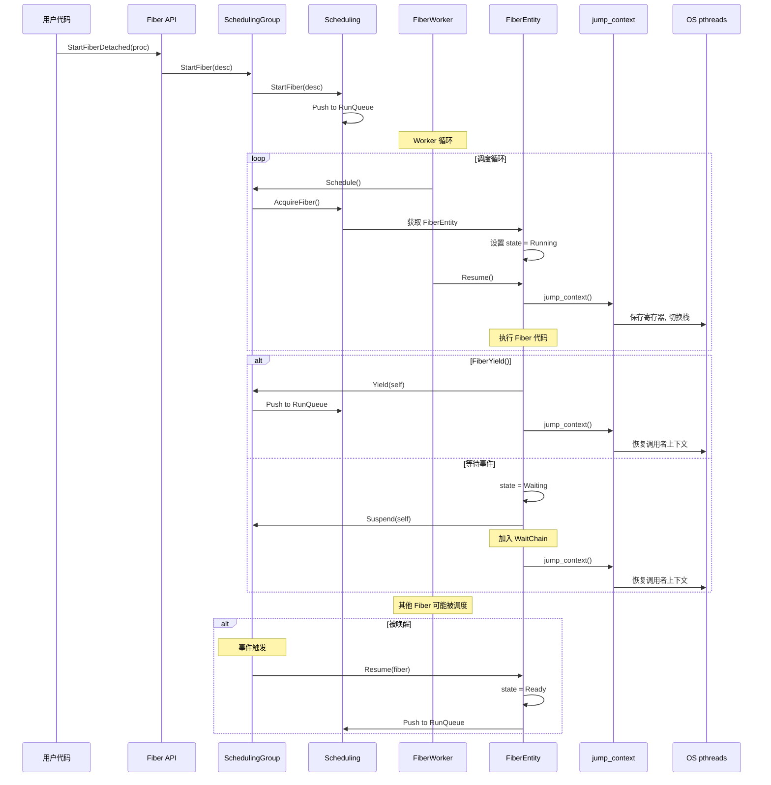
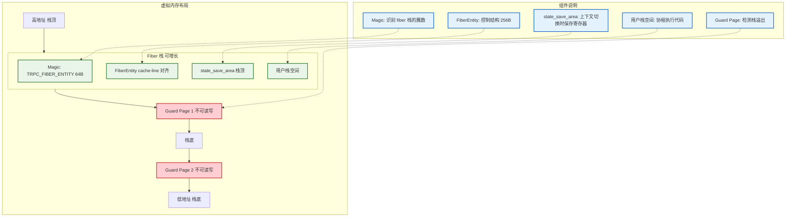
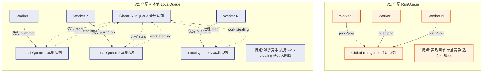
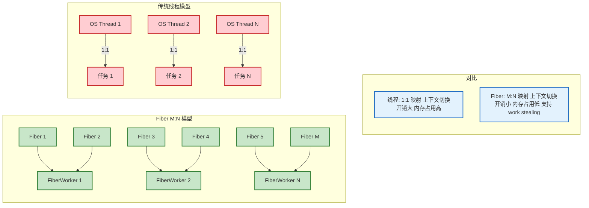
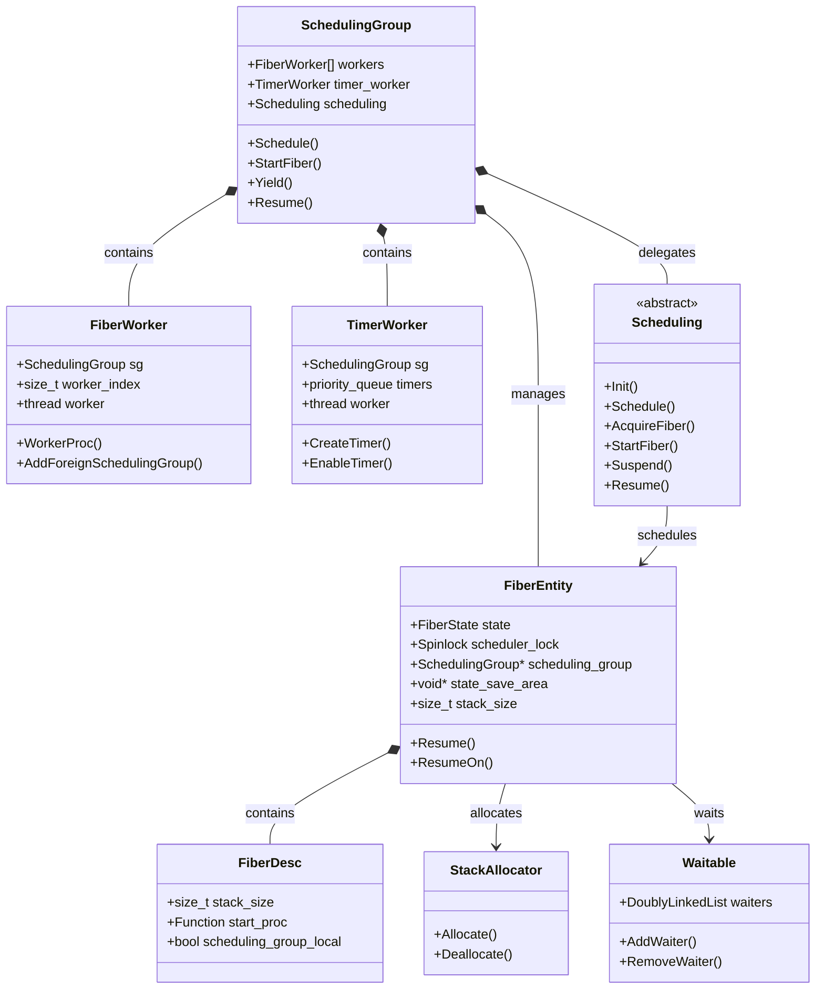

# tRPC-Cpp Fiber 体系架构

## 一、全景架构：Fiber 在 tRPC-Cpp 中的位置



## 二、层次架构：从用户到硬件


## 三、核心组件关系图



## 四、Fiber 调度数据流

```mermaid
flowchart TB
    Start(["用户调用 StartFiberDetached()"])
    CreateFiber["创建 FiberDesc"]
    PushQueue["推入 Global RunQueue"]
    Schedule["SchedulingGroup.Schedule()"]
    Acquire["FiberWorker.AcquireFiber()"]
    CheckLocal{"V2: 检查 LocalQueue"}
    CheckGlobal["检查 Global RunQueue"]
    Steal["从其他 Worker 偷取"]
    Restore["jump_context 恢复上下文"]
    Execute["执行 Fiber 代码"]
    Yield{"FiberYield()?"}
    Sleep{"等待事件?"}
    Wake["被唤醒 Resume"]
    Dead["Fiber 退出"]
    Free["释放 FiberEntity"]

    Start --> CreateFiber
    CreateFiber --> PushQueue
    PushQueue --> Schedule
    Schedule --> Acquire
    Acquire --> CheckLocal
    CheckLocal -->|"有任务"| Restore
    CheckLocal -->|"无任务"| CheckGlobal
    CheckGlobal -->|"有任务"| Restore
    CheckGlobal -->|"无任务"| Steal
    Steal -->|"成功"| Restore
    Steal -->|"失败"| Acquire
    Restore --> Execute
    Execute --> Yield
    Yield -->|"是"| PushQueue
    Yield -->|"否"| Sleep
    Sleep -->|"是"| Wake
    Sleep -->|"否"| Execute
    Wake --> Execute
    Execute --> Dead
    Dead --> Free

    classDef start fill:#c8e6c9,stroke:#2e7d32,stroke-width:3px
    classDef process fill:#e3f2fd,stroke:#1565c0,stroke-width:2px
    classDef decision fill:#fff3e0,stroke:#e65100,stroke-width:2px
    classDef end fill:#ffcdd2,stroke:#c62828,stroke-width:3px

    class Start start
    class CreateFiber,PushQueue,Schedule,Acquire,Restore,Execute,Wake process
    class CheckLocal,Sleep,Yield decision
    class Dead,Free end
```

## 五、Fiber 状态机与上下文切换



## 六、跨组件交互时序



## 七、内存布局与栈管理



## 八、V1 vs V2 调度器对比



## 九、Fiber 与线程模型对比



## 十、关键数据结构关系



## 十一、核心抽象层次总结

| 层次 | 抽象 | 职责 | 关键类 |
|------|------|------|--------|
| **L1: 用户接口** | 协程 API | 提供用户友好的协程创建/同步接口 | `Fiber`, `FiberLatch`, `FiberMutex` |
| **L2: 调度抽象** | 调度组 | 管理 Worker 线程和调度器 | `SchedulingGroup`, `Scheduling` |
| **L3: 执行引擎** | Fiber 实体 | 协程控制块和上下文切换 | `FiberEntity`, `jump_context` |
| **L4: 内存管理** | 栈分配 | 栈内存分配和保护 | `StackAllocator`, `MemoryPool` |
| **L5: 硬件抽象** | 寄存器 | CPU 寄存器保存/恢复 | `callee-saved registers` |

## 十二、源码目录结构

```
trpc/
├── runtime/threadmodel/fiber/          # Fiber 运行时
│   ├── fiber_thread_model.h/cc         # 线程模型入口
│   └── detail/
│       ├── scheduling_group.h/cc       # 调度组 核心
│       ├── fiber_worker.h/cc           # Worker 线程
│       ├── timer_worker.h/cc           # 定时器线程
│       ├── fiber_entity.h/cc           # Fiber 控制块
│       ├── fiber_desc.h/cc             # Fiber 描述符
│       ├── stack_allocator_impl.h/cc   # 栈分配器
│       ├── waitable.h/cc               # 等待链
│       ├── scheduling/
│       │   ├── scheduling.h/cc         # 调度器接口
│       │   ├── v1/scheduling_impl.h/cc # V1: 全局队列
│       │   └── v2/scheduling_impl.h/cc # V2: 本地队列
│       └── fcontext/
│           ├── x86_64/jump_context.S   # x86_64 上下文切换
│           └── aarch64/jump_context.S  # aarch64 上下文切换
└── coroutine/                          # 用户 API
    ├── fiber.h/cc                      # Fiber 类
    ├── fiber_latch.h/cc                # FiberLatch
    ├── fiber_condition_variable.h/cc   # FiberConditionVariable
    ├── fiber_event.h                   # FiberEvent
    ├── fiber_mutex.h                   # FiberMutex
    ├── fiber_local.h                   # FiberLocal
    └── future.h                        # Fiber Future
```
